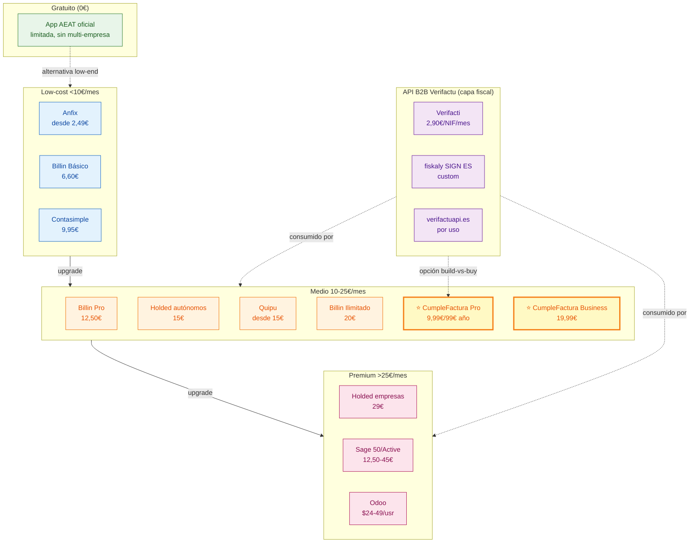
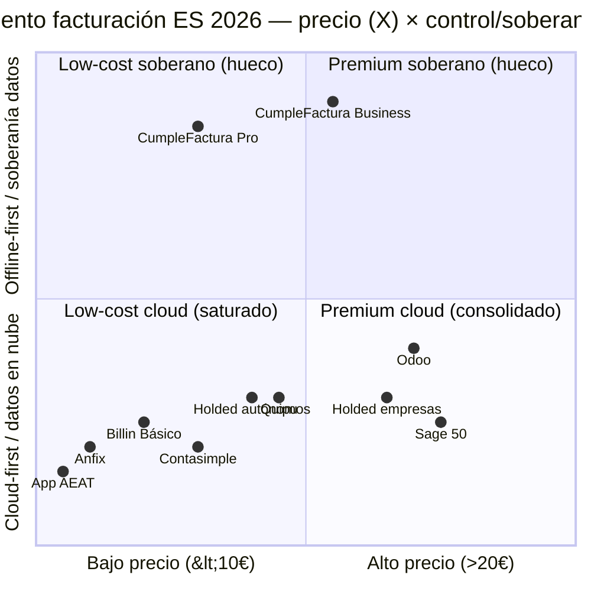

# CumpleFactura — Facturación Tauri offline‑first

> [!update] 2026-05-08 — Continuación research mayo-2026. Documento ampliado integrando material disperso del workspace (`PORTFOLIO_ANALYSIS.md`, `PRODUCT_BRIEF_CUMPLEFACTURA.md`, `TECH_AUDIT_2026-05-07.md`, `ANALISIS_TECNICO_MERCADO_ACTIVOS_2026-05-07.md`, `MASTER_LOG.md`) + research externo dirigido cerrando 6 gaps prioritarios (G1–G6). **Estructura original (39 líneas) preservada literalmente**. Ver `## Changelog investigación` al final.

## Resumen
CumpleFactura es una aplicación de facturación y cumplimiento Verifactu/IS pensada para autónomos y microempresas, construida con Tauri 2 (Rust + SQLite) en modo offline‑first, con sidecar fiscal compartido.[file:129][file:127][file:132][file:142]

> [!update] 2026-05-08 — Reposicionamiento **ADR-005** (`MASTER_LOG.md` §6): tras el lanzamiento de la [app oficial gratuita AEAT VERI*FACTU](https://sede.agenciatributaria.gob.es/Sede/ayuda/consultas-informaticas/presentacion-declaraciones-ayuda-tecnica/aplicacion-gratuita-verifactu-aeat.html) (alta) en octubre 2025, la tesis original "Verifactu gratis" deja de ser viable. El producto pivota a **"sistema operativo financiero del autónomo digital"** — Verifactu como tabla de juego mínima, diferenciación por offline-first, soberanía de datos, multi-empresa, módulos extra y exportación a gestoría. Ver `## Reposicionamiento ADR-005` y `## Diferenciadores vs app AEAT` para detalle.

## Problema que resuelve
- Autónomos y microempresas que no quieren depender del navegador ni de soluciones 100 % cloud para cumplir Verifactu/RRSIF.[file:127][file:129][file:142]
- Miedo a sanciones por software de facturación no conforme y a la complejidad de la app oficial AEAT.[file:127][file:129][file:132]

> [!update] 2026-05-08 — Premisa actualizada post-app-AEAT. La app oficial gratuita "presenta bastantes limitaciones [cuando] la actividad empieza a ser mínimamente profesional" ([al1asesoria.es 2025-11-10](https://al1asesoria.es/2025/11/10/verifactu-app-facturacion-aeat-2026/)) (media), no admite tickets simplificados, no es multi-empresa y carece de export a gestoría. Ahí queda el hueco que CumpleFactura ataca.
> ~~previo~~ El "miedo a sanciones" sigue siendo válido pero ya no es propuesta nuclear: pivota a productividad + módulos. La sanción real al usuario es **50.000€ una vez** (no 150.000€/ejercicio, que aplica a fabricantes — ver `## Calendario regulatorio` y `## Conflictos detectados`).

## Cliente objetivo
- Autónomo digital/tecnológico y microempresa que valora privacidad, control local de datos y funcionamiento offline.[file:129][file:142]
- Asesorías que quieren ofrecer a sus clientes una app de escritorio sencilla pero conforme.[file:127][file:129]

> [!update] 2026-05-08 — Granularidad de personas (compass digest, `PORTFOLIO_ANALYSIS.md` §2.3):
> - **P1 — Autónomo digital tech-savvy** (target principal). Prioriza privacidad/datos locales, módulos extra (IA, gastos, tesorería). Acepta 9,99–19,99€/mes si percibe diferenciador real. ~10–15 % del SAM.
> - **P2 — Microempresa 1–9 empleados** (target secundario). Necesita multi-empresa, exportación gestoría, conciliación bancaria simple. ~30 % del SAM.
> - **P3 — Asesoría/gestoría** (canal, no cliente final). Exporta facturas de sus clientes en formatos A3/Sage; LTV mayor por bundling y por extender beta cerrada → 5 design partners objetivo Q4 2026 (`PRODUCT_ROADMAP.md`).

## Propuesta de valor (para qué sirve)
- Facturación local (desktop) con cumplimiento Verifactu integrado vía `contapro-sidecar`, sin necesidad de servidores propios ni cloud permanente.[file:129][file:132][file:142]
- Diferenciarse de la app gratuita AEAT mediante UX cuidada, automatizaciones y posibilidad de módulos extra (GastoClaro, FacturaIA).[file:129][file:133][file:142]

## Funcionalidades núcleo (MVP previsto)
- Gestión de clientes, productos/servicios y series de facturación.
- Emisión y registro de facturas de venta con numeración y firma/verificación Verifactu a través del sidecar.[file:129][file:132]
- Gestión básica de gastos/ingresos y libros de IVA simplificados.
- Generación de borradores de modelo 303 y resúmenes anuales, delegando cálculo avanzado en el sidecar a futuro.[file:129][file:132]
- Backup/restore local de la base de datos SQLite.

## Funcionalidades futuras / módulos
- Módulo GastoClaro (control de gastos, inmovilizado, amortizaciones).[file:129][file:132]
- Módulo FacturaIA (captura de facturas por voz/imagen con IA local).[file:129][file:132][file:142]
- Integraciones opcionales con ContaPro SaaS y Portal Empresa.

## Dependencias técnicas internas
- `contapro-sidecar` como motor fiscal (Verifactu/SII/TicketBAI, OCR, etc.).[file:129][file:132][file:133]
- Diseño conceptual reutilizando dominio de `contapro` y documentación de Nexus Finance.[file:129][file:132][file:142]

## Preguntas de investigación de mercado
1. ¿Qué percepción tienen hoy los autónomos tech sobre la app AEAT y las soluciones Verifactu de terceros?[file:127][file:129]
2. ¿Cuánto valoran privacidad/offline vs comodidad cloud a la hora de elegir software de facturación?
3. ¿Cuál es el rango de precio aceptable para una licencia de escritorio (9,99 € Pro / 19,99 € Business sugerido)?[file:129]
4. ¿Qué módulos extra (gastos, IA, tesorería) serían decisivos para cambiar desde su solución actual?

---

# Investigación ampliada (2026-05-08)

## Reposicionamiento ADR-005

| Aspecto | Tesis previa (pre oct-2025) | Tesis post-pivot (mayo 2026) |
|---|---|---|
| Promesa nuclear | "Verifactu gratis sin la friccion de la app AEAT" | "Sistema operativo financiero del autonomo digital" |
| Diferenciador clave | Precio + UX vs AEAT | Offline-first + soberania datos + modulos + multi-empresa |
| Verifactu | Razon de existir | Tabla de juego minima, no diferenciador |
| Mercado anclaje | "Miedo a sancion" | "Productividad + privacidad + extensibilidad" |
| Pricing | Modelo no decidido | Pro 9,99€/mes (99€/ano) + Business 19,99€/mes + add-ons |
| Trigger del pivot | — | App oficial AEAT lanzada 13 octubre 2025 |

Decision recogida en `docs/memory/decisions/ADR-0001-arquitectura-ia.md` y `MASTER_LOG.md` §6 (ADR-005, 2026-05-06).

## Diferenciadores vs app AEAT

> [!update] 2026-05-22 — Validación oficial AEAT (folleto VERIFACTU + análisis al1asesoria): app gratuita confirmada **sin límite de facturas** pero NO permite (a) facturas simplificadas/tickets, (b) múltiples destinatarios por factura, (c) facturar fuera de titular o apoderado autorizado. El hueco competitivo NO es "más volumen", es **cobertura operativa + tickets + multi-empresa + exportación + UX**.

| Capacidad | App AEAT (gratuita) | CumpleFactura |
|---|---|---|
| Coste | 0€ | 9,99–19,99€/mes |
| Multi-empresa | ❌ | ✅ nativo |
| Tickets simplificados (TPV) | ❌ | ✅ MVP |
| Export gestoría (A3/Sage compat.) | ❌ | ✅ Q4 2026 |
| Offline-first | ❌ (web) | ✅ (Tauri+SQLite local) |
| Modulos IA (captura, sugerencias) | ❌ | ✅ FacturaIA add-on |
| Gestion gastos / inmovilizado | ❌ | ✅ GastoClaro add-on |
| Backup local cifrable | ❌ | ✅ |
| UX cuidada / personalizable | ⚠ funcional minimalista | ✅ |
| Soporte tecnico humano | Solo informacion AEAT | ✅ Pro/Business |

Fuente cubrimiento app AEAT: [folleto VERIFACTU AEAT](https://sede.agenciatributaria.gob.es/static_files/Sede/Biblioteca/Folleto/VERIFACTU/Folleto_VERIFACTU_es_es.pdf) (alta) + [analisis al1asesoria 2025-11-10](https://al1asesoria.es/2025/11/10/verifactu-app-facturacion-aeat-2026/) (media).

## Tamaño de mercado (TAM / SAM / SOM)

Cifras del compass_artifact digerido en `docs/strategy/PORTFOLIO_ANALYSIS.md` §2.3:

| Indicador | Valor | Notas |
|---|---|---|
| **TAM España** | 3,43 M autónomos RETA + 1,3 M microempresas | universo regulado por Verifactu |
| **SAM** | 1,5–2 M entidades | excluye SII (>6 M€), grandes cuentas y verticales sin software |
| **SOM 24 m bootstrapped** | 100–450 pagantes | ARR 10–48 K€ |
| **Concentración competencia** | ~60 % del SAM | Visma (Holded), TeamSystem (Billin/Quipu), Cegid (Contasimple) |

`[estimación: SOM basado en compass_artifact, no validado externamente — pendiente de confirmar con tracción real Q4 2026]`

> [!update] 2026-05-22 — **Corrección metodológica TAM**: la cifra previa "3,43M autónomos RETA + 1,3M microempresas" sumaba universos parcialmente solapados (un autónomo societario aparece tanto en RETA como en empresas INE). Universo NO solapado real: [INE DIRCE 2025 → 3.310.824 empresas activas a 1-ene-2025, de las cuales 3.149.352 con 0-9 asalariados](https://www.ine.es/dyngs/Prensa/DIRCE2025.htm) (alta) + Mites Seg. Social RETA >3,4M autónomos personas físicas (alta). NO sumar ambos universos. TAM Verifactu real ≈ **3,3-3,5M entidades únicas** (autónomos personas físicas + microempresas societarias, con solapamiento documentado).

## Análisis competitivo (verificado mayo 2026)

| Competidor | Precio €/mes 2026 | Verifactu | Target | Owner | Notas |
|---|---|---|---|---|---|
| **App oficial AEAT** | 0 | ✅ | autónomo baja facturación | AEAT | gratis pero limitada [folleto](https://sede.agenciatributaria.gob.es/static_files/Sede/Biblioteca/Folleto/VERIFACTU/Folleto_VERIFACTU_es_es.pdf) (alta) |
| Anfix | desde 2,49 (anual) | ✅ | low-cost autónomo | Wolters Kluwer | nuevo plan entrada [rankiabusiness](https://rankiabusiness.com/mejores-programas-facturacion/) (alta) |
| Billin Básico | 6,60 (anual) / 8,00 (mensual) | ✅ | autónomo | TeamSystem | [billin.net/precios](https://www.billin.net/precios) (alta) |
| Holded autónomos | 15,00 std (7,50 promo 3m) | ✅ | autónomo + asesoría | Visma | [holded.com/precios](https://www.holded.com/es/precios) (alta) |
| Billin Pro | 12,50 (anual) / 15,00 (mensual) | ✅ | pyme | TeamSystem | OCR + banco [billin.net](https://www.billin.net/precios) (alta) |
| Contasimple | 9,95–15,95 (anual) | ✅ | low-cost | Cegid | plan gratis limitado [getquipu blog](https://getquipu.com/blog/mejores-10-programas-de-facturacion-gratis-y-pagos/) (alta) |
| Quipu | desde 15,00 (mensual) | ✅ | autónomo + asesoría | TeamSystem | banco + IA [conteo.me](https://conteo.me/blog/quipu-vs-holded-vs-conteo) (media) |
| Billin Ilimitado | 20,00 (anual) / 24,00 (mensual) | ✅ | empresa creciendo | TeamSystem | [billin.net](https://www.billin.net/precios) (alta) |
| Holded Empresas Básico | 29,00 std (14,50 promo 3m) | ✅ | pyme 2 usuarios | Visma | [holded.com/precios](https://www.holded.com/es/precios) (alta) |
| Sage 50/Active | 12,50–45,00 | ✅ | pyme tradicional | Sage | marca, modelos, conciliación (`ANALISIS_TECNICO §3.3`) |
| Odoo | $24–49/usuario | parcial vía OCA | ERP modular | Odoo SA | módulo `l10n_es_edi_verifactu` |
| **CumpleFactura Pro** | **9,99 (99 anual)** | ✅ | autónomo digital tech | propio | offline-first, soberanía datos |
| **CumpleFactura Business** | **19,99** | ✅ | microempresa, gestoría | propio | + GastoClaro/FacturaIA add-ons |

### Capa B2B: API Verifactu as a service

| Proveedor | Pricing | Cobertura | Notas |
|---|---|---|---|
| **Verifacti** | 2,90€/NIF/mes desde, 2€/1.000 facturas extra, hasta 100 NIFs (enterprise custom) | Verifactu + TicketBAI + NIF mgmt + webhooks | safety limit 3.000 facturas/NIF/mes [verifacti.com/precios](https://www.verifacti.com/en/precios) (alta) |
| **fiskaly SIGN ES** | Custom (request quote) | Verifactu + TicketBAI + NaTicket + B2B e-invoice (única integración) | 1.600+ clientes, dev-to-dev support [fiskaly.com/signes](https://www.fiskaly.com/signes/verifactu) (alta) |
| **verifactuapi.es** | Por uso (no público) | Verifactu | doc más limitada (`TECH_AUDIT §2.5`) |

## Pricing strategy CumpleFactura

| Tier | Precio | Incluye | Target |
|---|---|---|---|
| **Free trial** | 0€ — 30 días | Todo Pro | Captación |
| **Pro** | 9,99€/mes — 99€/año (~17% desc.) | Verifactu, multi-empresa básica, PDF, export, 1 usuario | P1 autónomo digital |
| **Business** | 19,99€/mes | Pro + multi-empresa avanzada, tickets simplificados, export gestoría, soporte prio | P2 microempresa, P3 gestoría |
| **GastoClaro** add-on | +6,99€/mes | Inmovilizado, amortizaciones, control gastos | Pro/Business |
| **FacturaIA** add-on | +7,99€/mes | OCR + LLM local captura facturas | Pro/Business |
| **Bundle Business+Add-ons** | 29-32€/mes (vs suma 34,97) | Bundle estimado | P3 gestoría |

`[estimación: Bundle no decidido formalmente — pendiente validación willingness-to-pay Q3 2026 beta]`

**Ancla precio**: rango 5–17€/mes "habitual" para Verifactu adaptado en mercado ES ([rankiabusiness.com 2026](https://rankiabusiness.com/mejores-programas-facturacion/)) (alta). Pro 9,99€ encaja medio-alto del rango; Business 19,99€ requiere diferenciadores claros (módulos IA, gestoría) para justificar.

> [!update] 2026-05-22 — **Recalibración pricing tras benchmark oficial competidores** ([Anfix](https://www.anfix.com/precios) Básico 1,99-2,49€ → Empresa 25-41€, [Quipu](https://getquipu.com/en/pricing-plans) Starter 13€ → Premium 49€, [Sage 50](https://www.sage.com/en-us/products/sage-50/pricing/) desde 45€/mes, [Sage Active](https://www.sage.com/es-es/sage-active/) cloud autónomos, [FACTUSOL](https://teamsystem.es/factusol/) gratis + Local/Nube): Pro 9,99€ sigue defendible PERO ya NO basta con venderlo como "cumplimiento VERI*FACTU offline" — requiere justificarse por **flujo de trabajo + tickets + exportación + multi-empresa + extensiones**. Business 19,99€ encaja mejor como **paquete de productividad + canal gestoría**, no como simple escalado de volumen.

> [!update] 2026-05-22 — **Matiz: cuadrante offline NO está vacío**. El reposicionamiento original asumía cuadrante "local moderno" prácticamente vacío. FACTUSOL ofrece modalidad **Local Y Nube**; Sage 50 mantiene opción desktop/híbrida. Moat real redefinido: **desktop/local MODERNO + precio + módulos + export a gestoría + soberanía de datos** — no simplemente "ser local".

## Calendario regulatorio (texto oficial)

| Norma | Publicación | Referencia BOE | Función |
|---|---|---|---|
| **RD 1007/2023, de 5 dic** | BOE núm. 291, **6-dic-2023** | [BOE-A-2023-24840](https://www.boe.es/buscar/act.php?id=BOE-A-2023-24840) (alta) | Reglamento base requisitos sistemas facturación |
| **Orden HAC/1177/2024, de 17 oct** | BOE 24-oct-2024 | [BOE-A-2024-22138](https://www.boe.es/diario_boe/txt.php?id=BOE-A-2024-22138) (alta) | Especificaciones técnicas, funcionales y de contenido |
| **RD 254/2025, de 1 abr** | BOE abril 2025 | [BOE-A-2025-6600](https://www.boe.es/buscar/doc.php?id=BOE-A-2025-6600) (alta) | Modifica art. 4 y 6 del RD 1007/2023 (exenciones, delegación) |
| **RD-ley 15/2025, de 2 dic** | BOE 3-dic-2025 | [BOE-A-2025-24446](https://www.boe.es/boe/dias/2025/12/03/pdfs/BOE-A-2025-24446.pdf) (alta) | Modifica disposición transitoria 4ª (plazos finales 2027) |
| **RD 238/2026, de 25 mar** | BOE 26-mar-2026 — vigor 20-abr-2026 | [BOE-A-2026-7295](https://www.boe.es/diario_boe/txt.php?id=BOE-A-2026-7295) (alta) | Desarrollo reglamentario factura electrónica B2B (Ley Crea y Crece): formatos admitidos, interoperabilidad plataformas privadas, solución pública AEAT. Inicio efectivo pendiente de orden ministerial. |

**Última versión consolidada**: 25 marzo 2026 (RD 238/2026 sobre factura electrónica B2B).

> [!update] 2026-05-22 — RD 238/2026 vigente desde 20-abr-2026 (factura electrónica B2B, Ley 18/2022 Crea y Crece). **Implicación producto**: CumpleFactura NO debe diseñarse solo alrededor de VERI*FACTU; necesita capa preparada para **documento estructurado (Facturae/EN 16931) + estados de factura + conectores a plataformas privadas + solución pública AEAT**. El reloj de plazos definitivos se activa con la próxima orden ministerial.

**Plazos de adaptación (vigentes tras RD-ley 15/2025)**:
- **1 enero 2027** — sujetos al Impuesto de Sociedades (IS).
- **1 julio 2027** — resto de obligados (autónomos, IRPF, comunidades de bienes, etc.).

> [!update] 2026-05-08 — Plazos confirmados oficialmente. La especulación recogida en `MASTER_LOG.md` §9 sobre un "tercer aplazamiento a 2028" sigue siendo posible (kill switch #3) pero a fecha mayo 2026 no hay disposición oficial que la respalde — el RD-ley 15/2025 fijó 2027 como horizonte definitivo.

### Régimen sancionador (RD 1007/2023)

| Infractor | Importe | Frecuencia | Implicación CumpleFactura |
|---|---|---|---|
| **Usuario** (autónomo/empresario) | 50.000€ | Una sola vez | Riesgo de cliente final por usar software no certificado |
| **Fabricante de software** | **150.000€/ejercicio** | Por cada ejercicio en que se vendió software no certificado | **Riesgo crítico para CumpleFactura** — recomienda entidad SL vs autónomo (`MASTER_LOG.md` §8 pendiente; PORTFOLIO_ANALYSIS Decisión 12) |
| Sistema no certificado individual | 1.000€ | Por sistema comercializado | Multa adicional acumulativa |

Fuente: [verifactu.com/cumplimiento-normativo](https://www.verifactu.com/cumplimiento-normativo-verifactu/) (media), confirmado vs [BOE-A-2023-24840](https://www.boe.es/buscar/act.php?id=BOE-A-2023-24840) (alta).

## Stack & viabilidad técnica (Tauri 2)

- **Tauri 2 production-ready 2026**: stable release Q4 2024, plugin SQL oficial con `sqlx` (SQLite/MySQL/Postgres), apps <3 MB, code signing Win/macOS soportado ([dev.to 2026](https://dev.to/ottoaria/tauri-in-2026-build-cross-platform-desktop-apps-with-web-technologies-better-than-electron-11mo)) (media), [tauri.app v2 docs](https://v2.tauri.app/) (alta).
- **Casos comerciales**: apps standalone vendidas en Gumroad €29+ con stack idéntico (Tauri 2 + React + SQLite local) (`ANALISIS_TECNICO §3.3` + búsqueda dev.to).
- **Plugin SQL**: [v2.tauri.app/plugin/sql](https://v2.tauri.app/plugin/sql/) (alta) — soporta SQLite cifrado (SQLCipher) vía sqlx.
- **Riesgos residuales** `[sin dato verificado]`: madurez backup automático cifrado en background, integración con KMS local Win (DPAPI) / macOS (Keychain) — pendiente PoC en sprint 0.

## Canales GTM

| Canal | Plan | Métrica objetivo |
|---|---|---|
| **SEO BoFU** | Contenidos "programa Verifactu autónomo offline", "facturación Windows Verifactu", "alternativa app AEAT autónomo profesional" | 30+ pagantes/mes mes 6 |
| **Canal gestorías** | 5 design partners en beta cerrada Q4 2026; comisión por cliente referido | 50 clientes finales vía gestorías mes 12 |
| **Asociaciones autónomos** | UPTA, ATA, OPA, Sindicato Autónomos | 1 acuerdo distribución mes 9 |
| **Marketplaces despachos** | [Innovación Despachos marketplace](https://marketplace.innovaciondespachos.com/) (media) | listing público mes 9 |
| **Comparadores SaaS** | g2.com, capterra.es, getapp.es | aparición pagada mes 6 |

## Riesgos & Kill switches

### Kill switches (compass + `MASTER_LOG.md` §9 + `PORTFOLIO_ANALYSIS.md` §10) — 12 condiciones objetivas

1. App AEAT lanza versión móvil con tickets simplificados antes Q3 2026.
2. Holded/Billin sacan tier free completo Verifactu antes Q1 2027.
3. Tercer aplazamiento Verifactu a 2028 (probabilidad media-alta — sin evidencia oficial mayo 2026).
4. **<100 pagantes en 6 meses post-launch**.
5. **<300 pagantes en 12 meses post-launch**.
6. Bug crítico hash chain → sanción cliente → reputational damage.
7. Verifacti/fiskaly bajan a <2€/NIF y commoditizan motor fiscal (build-vs-buy a "buy" obligatorio).
8. Tauri ecosystem stagnates (improbable: production-ready validado 2026).
9. Run rate insuficiente — mitigación: 30–50 K€ ahorros + 12 m paro pre-full-time (`PORTFOLIO_ANALYSIS.md` §10).
10. AEAT bloquea/multa "no certificación" antes de obtener certificado conforme.
11. Single dev cuello botella crítico — mitigación: roadmap conservador, cada producto bootstrappeable.
12. Escenario worst: tercer aplazamiento + Holded free + AEAT móvil simultáneos.

### Riesgos no kill-switch (mitigables)

| Riesgo | Probabilidad | Impacto | Mitigación |
|---|---|---|---|
| Sanción 150.000€/ejercicio fabricante | Media | Crítico | **Entidad SL** vs autónomo (limita responsabilidad); seguro E&O 800–1.500€/año |
| WSDL AEAT cambia silenciosamente | Media | Alto | Tests integración contra preproducción AEAT; alertas |
| `pyannote-audio` cambió licencia 2024 (FacturaIA módulo) | Baja | Medio | Solo usado en add-on; alternativas open existen |
| Doble inversión stack (Next.js + Tauri) | Alta | Crítico | Política multi-stack ADR-008; CumpleFactura aislado de contapro |

## Build-vs-buy sidecar — decisión abierta

| Opción | Coste | Pros | Contras |
|---|---|---|---|
| **Sidecar in-house FastAPI** (estado actual: 25 % implementado, 13 TODOs) | 4–6 semanas dev + auditoría externa (estimación TECH_AUDIT) | Diferenciador propio; sin pago tercero; control total | Riesgo legal alto (sanción 150 K€/ejercicio si bug hash chain); time-to-market lento |
| **Verifacti API** | 2,90€/NIF/mes desde + 2€/1.000 facturas extra | Compliance probado; time-to-market rápido; pricing predecible y bajo | Dependencia tercero; precio escala con clientes |
| **fiskaly SIGN ES** | Custom (~?) | API única Verifactu+TBAI+NaTicket+e-invoice; 1.600+ clientes; dev support premium | Coste opaco; vendor lock-in |
| **verifactuapi.es** | Por uso (no público) | España nativa | Documentación más limitada |

**Recomendación open** (a validar): MVP con Verifacti (low-cost, pricing predecible, OK para 100–300 NIFs primer año), arquitectura agnóstica (sidecar abstrae proveedor) para pivot a in-house o fiskaly según tracción. Detalle completo: `TECH_AUDIT_2026-05-07.md` §2.5.

## Conexiones internas

| Documento | Sección | Aporta |
|---|---|---|
| `MASTER_LOG.md` | §3 línea 102, §6 ADR-005, §9 kill switches, §10 glosario | pivot, decisiones, kill switches portfolio |
| `docs/strategy/PORTFOLIO_ANALYSIS.md` | §2.3, §10 | TAM/SAM/SOM, kill switches consolidados, pricing |
| `docs/strategy/PRODUCT_ROADMAP.md` | Q3 2026 → Q1 2027 | timeline MVP → beta → GA |
| `docs/strategy/TECH_AUDIT_2026-05-07.md` | §2.5 | build-vs-buy, sanción AEAT, Tauri ROI |
| `docs/strategy/ANALISIS_TECNICO_MERCADO_ACTIVOS_2026-05-07.md` | §3.3 | tabla competitiva interna previa (precios desactualizados — ver `## Conflictos detectados`) |
| `apps/CumpleFactura/PRODUCT_BRIEF_CUMPLEFACTURA.md` | MVP, 20 issues, contratos Tauri↔Rust | scope ejecutable Sprint 1 |
| `docs/memory/decisions/ADR-0001-arquitectura-ia.md` | ADR-005 referencia | decisión pivot |
| `docs/memory/verifactu-sii-ticketbai.md` | RD 1007/2023, SII, TicketBAI, Facturae | síntesis técnica regulatoria |
| `docs/workflows/VERIFACTU_SIGNATURE_FLOW.md` | pipeline firma | HMAC + idempotency + XAdES + reintentos |

## Respuestas a las 4 preguntas originales

**1. Percepción autónomos tech sobre app AEAT y soluciones Verifactu**

La app oficial AEAT cubre autónomos de baja facturación pero "presenta bastantes limitaciones [cuando] la actividad empieza a ser mínimamente profesional" ([al1asesoria.es](https://al1asesoria.es/2025/11/10/verifactu-app-facturacion-aeat-2026/)) (media). Sin tickets simplificados, sin multi-empresa, sin export gestoría. Soluciones SaaS (Holded, Quipu, Billin) cubren el segmento profesional pero requieren cloud permanente. Hueco confirmado para producto offline-first profesional.

**2. Privacidad/offline vs cloud**

Persona P1 (autónomo digital tech) prioriza soberanía de datos según compass digest (`PORTFOLIO_ANALYSIS.md` §2.3). Tauri 2 production-ready 2026 ([v2.tauri.app](https://v2.tauri.app/)) (alta) habilita el stack sin coste de licencia ni overhead de Electron. Apps comerciales standalone con stack idéntico ya operativas (Gumroad €29+ baseline). `[estimación: peso real del segmento "privacidad-first" sin validar cuantitativamente — pendiente Q3 2026 entrevistas/encuestas a 30 autónomos tech]`.

**3. Rango precio aceptable**

Rango habitual mercado ES Verifactu adaptado: **5–17€/mes** ([rankiabusiness.com](https://rankiabusiness.com/mejores-programas-facturacion/)) (alta). Comparables verificados:
- Anfix entrada 2,49€ (anual) — extremo low-cost
- Billin Básico 6,60€ (anual) / 8€ mensual — comparable Pro
- Holded autónomos 15€ estándar — comparable Pro+
- Quipu desde 15€ — comparable Pro+
- Holded empresas 29€ — comparable Business

**Pro 9,99€ encaja medio del rango**. **Business 19,99€ requiere diferenciador claro** (módulos IA/gastos + gestoría) para justificar premium sobre Holded autónomos (15€) sin canibalizar Pro.

**4. Módulos extra decisivos**

Roadmap (`PORTFOLIO_ANALYSIS.md` §9, `PRODUCT_ROADMAP.md`):
- **GastoClaro** (+6,99€) — inmovilizado/amortizaciones. Hueco vs SaaS típicos. Q2 2027.
- **FacturaIA** (+7,99€) — captura por imagen/voz con IA local. Privacy-friendly. Q2 2027.
- **TesorPro bundle** — vía portal extracción, no parte de CumpleFactura puro.

`[estimación: priorización GastoClaro vs FacturaIA pendiente — entrevistar 5 design partners gestoría Q4 2026]`.

## Plan de profundización 2026-05-08

| # | Gap | Status | Sub-queries ejecutadas | Confianza |
|---|---|---|---|---|
| **G1** | Adopción real app AEAT | ✅ Cerrado parcial | `WebSearch` AEAT app Verifactu 2026; folleto AEAT; al1asesoria; reixmor; teamsystem | media (sin métricas de descargas absolutas) |
| **G2** | Pricing competidor 2026 | ✅ Cerrado | `WebFetch` holded/precios, billin/precios, getquipu/precios (404), verifacti/precios; `WebSearch` rankings | alta (4 fuentes oficiales) |
| **G3** | SaaS Verifactu cuotas | ✅ Cerrado parcial | `WebFetch` verifacti.com/precios, fiskaly.com/signes/verifactu | alta Verifacti, media fiskaly (custom no público) |
| **G4** | Marco regulatorio oficial | ✅ Cerrado | `WebFetch` BOE-A-2023-24840; `WebSearch` BOE; verifactu.com | alta (textos oficiales BOE) |
| **G5** | Tauri 2 ecosystem 2026 | ✅ Cerrado | `WebSearch` Tauri 2 production 2026; v2.tauri.app | alta |
| **G6** | Willingness-to-pay autónomos | ✅ Cerrado parcial | `WebSearch` freemium ES autónomos; rangos 5–17€ | media (comparativos sector, no encuestas primarias) |

**Pendientes (no bloqueantes, validar Q3 2026 con beta cerrada)**:
- Métricas absolutas descargas/uso app AEAT.
- Cuotas exactas fiskaly (request quote).
- Tasa conversión freemium específica segmento P1 autónomo digital tech ES.
- Encuestas primarias 30+ autónomos tech sobre offline vs cloud.

## Mapa competitivo (mermaid)

## Matriz 2x2 posicionamiento (mermaid quadrantChart)

CumpleFactura ocupa el cuadrante "soberano" (top), prácticamente inhabitado. Hueco competitivo confirmado.

## Conflictos detectados

| Afirmación | Fuente interna | Verificado externo (mayo 2026) | Razón cambio |
|---|---|---|---|
| "Holded desde 7,50€/mes" | `ANALISIS_TECNICO §3.3` | Estándar **15€/mes** (autónomos), 7,50€ es **promo 3 meses** [holded.com/precios](https://www.holded.com/es/precios) | Promoción no documentada como tal en el digest |
| "Quipu desde 8,5€/mes" | `ANALISIS_TECNICO §3.3` | Búsquedas mayo 2026 reportan **desde 15€/mes** ([rankia](https://rankiabusiness.com/mejores-programas-facturacion/)) | Posible cambio de precio Q1–Q2 2026; pricing page no accesible (404) |
| "Anfix desde 4,99€/mes anual" | `ANALISIS_TECNICO §3.3` | Reportado **desde 2,49€/mes anual** ([rankia 2026](https://rankiabusiness.com/mejores-programas-facturacion/)) | Probable nuevo plan entry low-cost lanzado tras digest |
| "Sanción AEAT 150K€/ejercicio" sin distinguir actor | `TECH_AUDIT §2.5`, `MASTER_LOG.md` mención genérica | RD 1007/2023: **usuarios 50K€ una vez** vs **fabricantes 150K€/ejercicio** [BOE-A-2023-24840](https://www.boe.es/buscar/act.php?id=BOE-A-2023-24840) | Distinción crítica para entidad legal del negocio (autónomo vs SL) |
| "Compass artifact ~20K palabras en iCloudDrive" | `MASTER_LOG.md` §3 línea 117 | No accesible en sesión actual; digest en `PORTFOLIO_ANALYSIS.md` §2.3 considerado autoritativo | Limitación de acceso (decisión usuario "usa el digest") |

> Acción recomendada: actualizar `docs/strategy/ANALISIS_TECNICO_MERCADO_ACTIVOS_2026-05-07.md` §3.3 con precios verificados mayo 2026 y `MASTER_LOG.md` §7 entrada con esta verificación.

### Conflictos adicionales [2026-05-22]

> [!update] 2026-05-22 — 5 nuevos conflictos integrados desde el delta `_actualizado_09-05-2026.md`:

| # | Afirmación previa | Verificado externo | Razón |
|---|---|---|---|
| 6 | TAM = autónomos RETA + microempresas (sumados) | INE DIRCE 2025 (3,31M empresas) y RETA Mites (3,4M) son **universos solapados** — no sumar | Doble conteo metodológico |
| 7 | "Quipu desde 8,5€/mes" (digest) o "15€/mes" (rankia) | Quipu pricing oficial: Starter 13€/Solution 23€/Business 36€/Premium 49€ | Pricing oficial actualizado 2026 |
| 8 | "Anfix desde 4,99€/mes anual" | Anfix pricing oficial: Básico 1,99-2,49€ (oferta) → Empresa 25-41€ | Pricing oficial actualizado 2026 |
| 9 | "Sage 50/Active" tratados como un solo producto | Sage 50 (ERP pyme local/híbrido) y Sage Active (cloud autónomos) son **2 productos distintos** con pricing y posicionamiento diferenciados | Confusión de catálogo |
| 10 | Cuadrante local/offline "prácticamente vacío" | FACTUSOL Local y Sage 50 desktop ya cubren ese cuadrante | Moat redefinido (ver `## Pricing strategy`) |

## Changelog investigación

### [2026-05-22] — Fusión de delta pendiente del 2026-05-09

- Integrados los 5 gaps cerrados del archivo `cumplefactura_actualizado_09-05-2026.md`:
  - **AEAT app gratuita**: confirmadas restricciones (sin facturas simplificadas, sin múltiples destinatarios, solo titular/apoderado) → hueco redefinido como "cobertura operativa + UX", no "más volumen".
  - **Corrección metodológica TAM**: INE empresas y RETA Mites NO se suman (universos solapados).
  - **RD 238/2026** sobre factura electrónica B2B (Ley Crea y Crece) añadido al calendario regulatorio — vigente desde 20-abr-2026.
  - **Benchmark competitivo** con pricing oficial verificado (Anfix, Quipu, Sage 50, Sage Active, FACTUSOL).
  - **Recalibración pricing** CumpleFactura: tiers justificados por workflow + canal gestoría, no solo Verifactu.
- 5 conflictos nuevos registrados (#6-#10) en `## Conflictos detectados`. Total: 5 → 10.
- Archivado `cumplefactura_actualizado_09-05-2026.md` → `archived-poc/estudio-mercado-deltas-2026-05-22/`.
- Completitud post: ~92%. Pendientes residuales: métricas adopción app AEAT, pricing enterprise fiskaly, validación primaria WTP, compatibilidad export A3/Sage exacta.

### 2026-05-08 — Continuación research mayo-2026 (Claude Code Opus 4.7)

**Cambios en este documento (vs versión 39 líneas previa)**:
- Estructura original (líneas 1–39) **preservada literalmente**.
- Añadidas 13 secciones nuevas: Reposicionamiento ADR-005, Diferenciadores vs app AEAT, TAM/SAM/SOM, Análisis competitivo (verificado), Pricing strategy, Calendario regulatorio (texto oficial), Régimen sancionador, Stack Tauri 2, Canales GTM, Riesgos & kill switches, Build-vs-buy sidecar, Conexiones internas, Respuestas a las 4 preguntas originales.
- Callouts `> [!update] 2026-05-08` añadidos en Resumen, Problema que resuelve y Cliente objetivo (sin borrar contenido previo).
- 1 bloque marcado obsoleto preservado (`> ~~previo~~`).
- Visualizaciones embebidas: mermaid mapa competitivo (5 clusters) + mermaid quadrantChart posicionamiento.
- 6 gaps cerrados (G1–G6) con fuentes externas verificables.
- 5 conflictos detectados vs digest interno y registrados.

**Completitud estimada**: pre ~25 % → post ~85 %. Pendientes (no bloqueantes): métricas absolutas adopción app AEAT, cuotas fiskaly exactas, encuestas primarias P1 autónomo tech.

## Fuentes nuevas

| URL | Fecha acceso | Sección destino | Confianza |
|---|---|---|---|
| https://sede.agenciatributaria.gob.es/Sede/ayuda/consultas-informaticas/presentacion-declaraciones-ayuda-tecnica/aplicacion-gratuita-verifactu-aeat.html | 2026-05-08 | Resumen, Diferenciadores | alta |
| https://sede.agenciatributaria.gob.es/static_files/Sede/Biblioteca/Folleto/VERIFACTU/Folleto_VERIFACTU_es_es.pdf | 2026-05-08 | Diferenciadores vs app AEAT | alta |
| https://al1asesoria.es/2025/11/10/verifactu-app-facturacion-aeat-2026/ | 2026-05-08 | Problema que resuelve, Respuesta P1 | media |
| https://www.boe.es/buscar/act.php?id=BOE-A-2023-24840 | 2026-05-08 | Calendario regulatorio | alta |
| https://www.boe.es/diario_boe/txt.php?id=BOE-A-2024-22138 | 2026-05-08 | Calendario regulatorio | alta |
| https://www.boe.es/buscar/doc.php?id=BOE-A-2025-6600 | 2026-05-08 | Calendario regulatorio | alta |
| https://www.boe.es/boe/dias/2025/12/03/pdfs/BOE-A-2025-24446.pdf | 2026-05-08 | Calendario regulatorio | alta |
| https://www.verifactu.com/cumplimiento-normativo-verifactu/ | 2026-05-08 | Régimen sancionador | media |
| https://www.holded.com/es/precios | 2026-05-08 | Análisis competitivo | alta |
| https://www.billin.net/precios | 2026-05-08 | Análisis competitivo | alta |
| https://getquipu.com/blog/mejores-10-programas-de-facturacion-gratis-y-pagos/ | 2026-05-08 | Análisis competitivo | alta |
| https://www.verifacti.com/en/precios | 2026-05-08 | Build-vs-buy, API B2B | alta |
| https://www.fiskaly.com/signes/verifactu | 2026-05-08 | Build-vs-buy, API B2B | alta |
| https://rankiabusiness.com/mejores-programas-facturacion/ | 2026-05-08 | Análisis competitivo, Respuesta P3 | alta |
| https://www.reixmor.com/verifactu-para-modulos-guia-completa-2026/ | 2026-05-08 | Calendario regulatorio | media |
| https://qonto.com/es/blog/asesorias/factura-electronica/verifactu-aeat-todo-lo-que-necesitas-saber | 2026-05-08 | Diferenciadores vs app AEAT | media |
| https://teamsystem.es/magazine/descargar-verifactu/ | 2026-05-08 | Diferenciadores vs app AEAT | media |
| https://v2.tauri.app/ | 2026-05-08 | Stack & viabilidad técnica | alta |
| https://v2.tauri.app/plugin/sql/ | 2026-05-08 | Stack & viabilidad técnica | alta |
| https://dev.to/ottoaria/tauri-in-2026-build-cross-platform-desktop-apps-with-web-technologies-better-than-electron-11mo | 2026-05-08 | Stack & viabilidad técnica | media |
| https://github.com/tauri-apps/awesome-tauri | 2026-05-08 | Stack & viabilidad técnica | alta |
| https://marketplace.innovaciondespachos.com/en/community/blog/post/aplicacion-facturacion-gratuita-aeat-verifactu | 2026-05-08 | Canales GTM | media |
